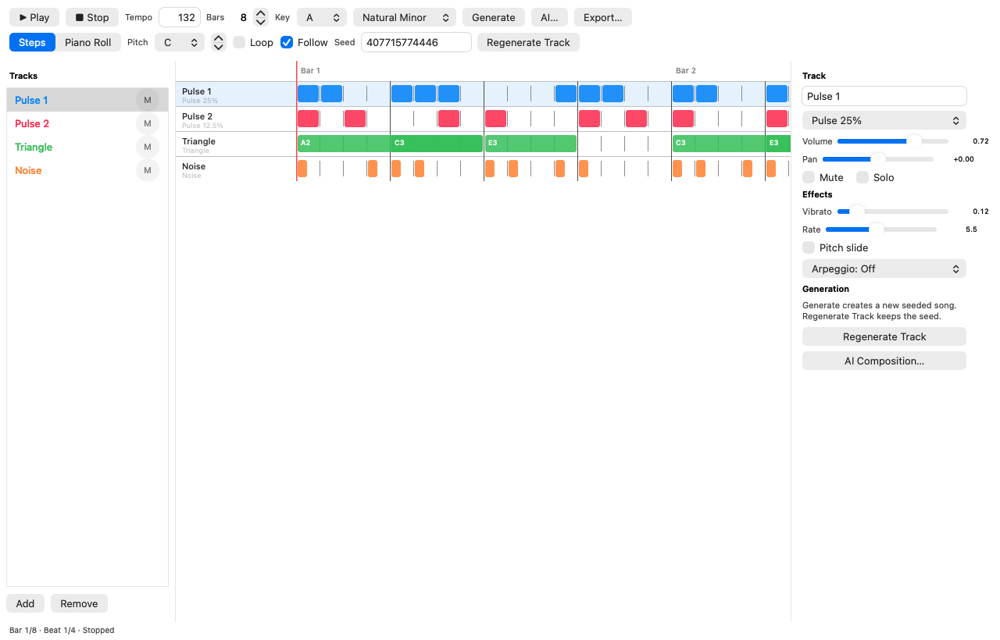
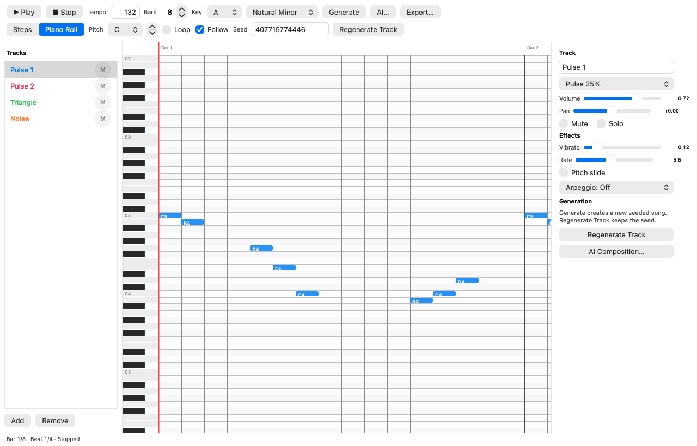
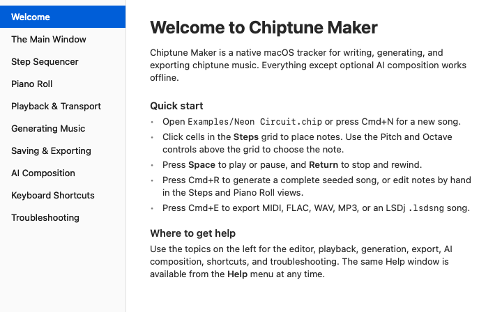
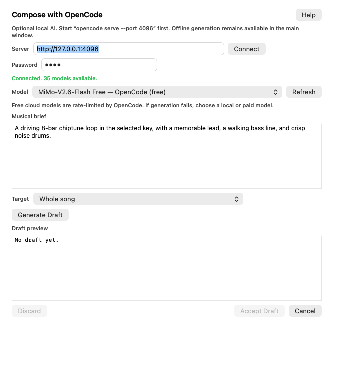

# Chiptune Maker

A native macOS chiptune composer and tracker written in Objective-C with AppKit. It uses real `NSDocument` windows, menus, toolbars, split views, custom `NSView` editors, and sheets — no SwiftUI, no web view, and no Electron.





## Features

- **Native document app** — `.chip` files, autosave, recent documents, dirty-state tracking, and undo/redo.
- **Multi-track sequencer** — four default tracks (Pulse 1, Pulse 2, Triangle, Noise), up to eight tracks.
- **Piano roll** — click to add notes, drag to move, drag the right edge to resize, delete, and nudge with the arrow keys.
- **Chip synthesis** — pulse waves (12.5%, 25%, 50%), NES-style triangle, 15-bit LFSR noise, and wavetable voices with ADSR, vibrato, pitch slide, and arpeggio.
- **Real-time playback** — `AVAudioEngine` with an `AVAudioSourceNode` pulling from the same renderer used for offline export. Tempo, volume, pan, mute, solo, instrument, vibrato, pitch slide, and arpeggio update live while the song plays. Playback stops automatically at the final bar unless **Loop** is enabled.
- **Seeded generation** — deterministic offline composition with SplitMix64; regenerating one track leaves the others untouched.
- **Optional OpenCode AI** — connects to a local `opencode serve` instance, lists available models, labels local and rate-limited free models, validates the returned JSON strictly, previews a draft, and applies it as one undoable edit.
- **Built-in Help** — a topic-based Help window covers the editor, playback, generation, export, AI composition, shortcuts, and troubleshooting.
- **Export** — Standard MIDI File, FLAC, WAV, MP3, and Little Sound DJ `.lsdsng` songs.

## Requirements

- macOS 14 Sonoma or later.
- Xcode 16 or later with the command-line tools.
- [XcodeGen](https://github.com/yonaskolb/XcodeGen): `brew install xcodegen`.
- Optional: LAME for MP3 export: `brew install lame`.
- Optional: OpenCode 2.2.x for AI composition.

## Build, test, and run

```sh
xcodegen generate

xcodebuild -project ChiptuneMaker.xcodeproj -scheme ChiptuneMaker \
  -configuration Debug -derivedDataPath build build CODE_SIGNING_ALLOWED=NO

xcodebuild -project ChiptuneMaker.xcodeproj -scheme ChiptuneMaker \
  -destination 'platform=macOS' -derivedDataPath build test CODE_SIGNING_ALLOWED=NO

open build/Build/Products/Debug/ChiptuneMaker.app
```

The app is sandbox-disabled and hardened-runtime enabled, matching the direct-distribution. The generated `.xcodeproj` is a build artifact; edit `project.yml` and rerun `xcodegen generate` when adding files.

## Using the app

- **Steps** — click a cell to add or remove a note at the selected pitch; drag to paint. The Pitch and octave controls choose the pitch. Scroll the timeline with a mouse wheel, a horizontal trackpad swipe, or Shift+scroll; dragging near the edge while painting scrolls automatically.
- **Piano Roll** — click empty space to add a note, drag a note to move it, drag its right edge to resize it, press Delete to remove it, and use the arrow keys to nudge it. Shift+scroll or a horizontal swipe moves along the timeline; a normal wheel scrolls pitches.
- **Key and Scale** — changing Key transposes every pitched note by the shortest semitone distance to the new root. Changing Scale snaps pitched notes to the nearest note in the selected key and scale. Noise tracks keep their drum pitches.
- **Transport** — Space plays or pauses when the editor has focus; Return stops and rewinds; the toolbar has Play and Stop buttons. Playback stops automatically at the end of the song, or repeats when **Loop** is on; press Play after the end to rewind and restart. **Follow** is on by default so the editor scrolls with the playhead; scrolling manually during playback turns Follow off so the timeline stays where you put it. Tempo, mixer, instrument, and effect changes apply without restarting playback.
- **Generate** — Cmd+R creates a new seeded song. **Regenerate Track** reuses the song seed for the selected track.
- **Export** — Cmd+E opens the export sheet. Choose FLAC, MP3, WAV, MIDI, or LSDj. Audio exports render through the same `ChipRenderer` used for playback. LSDj export writes a single-song `.lsdsng` file: each bar becomes a 16-step phrase, groups of up to 16 bars become chains, and each chain group occupies one song row. Pulse tracks map to PU1/PU2, triangle and wavetable tracks to WAVE, and noise tracks to NOISE; one LSDj instrument is created per audible track.

An example project is included at `Examples/Neon Circuit.chip`; open it with the app to hear a complete four-track song.

## Help

Press **Cmd+?** or choose **Help > Chiptune Maker Help**. The Help window explains the main window, step sequencer, piano roll, playback, seeded generation, saving and export, AI composition, keyboard shortcuts, and troubleshooting. **Help > AI Composition Help** opens the AI topic directly.



## OpenCode AI setup

1. Start the server:

   ```sh
   opencode serve --port 4096
   ```

2. Open **AI Composition…** in the app.
3. Enter the server URL and the password printed by `opencode serve`.
4. Click **Connect**, choose a model, write a brief, and click **Generate Draft**.
5. Review the draft, then **Accept Draft** or **Discard**.

The server uses HTTP Basic authentication with the username `opencode` and the printed password. The app handles this and stores the password in the macOS Keychain when you connect normally.

No model is hardcoded: the list comes from `GET /api/model?types=chat`. The menu labels models so the quota behavior is visible:

- **(local)** models run on this Mac through Ollama or llama.cpp. They have no cloud quota.
- **(free)** models are hosted by OpenCode and are rate-limited. The quota is enforced by OpenCode, not by Chiptune Maker.
- Models without a suffix use the provider credentials configured in OpenCode.

If a free model reports that its usage limit is reached, the app automatically retries with a local model when one is available, preferring Ollama. You can also choose a paid/provider model. The app sends OpenCode's own model ID rather than the upstream provider ID, so custom providers such as Charrasmia work correctly.

AI is optional and all offline features continue to work without a server.



## MP3 export

MP3 encoding invokes a local `lame` executable. The app checks `/opt/homebrew/bin/lame`, `/usr/local/bin/lame`, `/usr/bin/lame`, and `PATH`. If LAME is missing, MP3 export reports a clear error; FLAC, WAV, and MIDI export are unaffected.

A bundled `libmp3lame.dylib` is not included in this build. If you distribute the app, either bundle LAME under the LGPL (dynamic linking, license text, attribution) or document the external dependency as this build does.

## File format

`.chip` files are versioned JSON (UTI `com.sid.chiptune.song`). The format stores tempo, meter, key/scale, swing, song length, sections, tracks, notes, effects, and generation settings. Internal timing is 480 PPQ. The 64-bit seed is stored as a decimal string so JSON number precision cannot change it. Unknown fields are ignored; newer format versions are rejected with a clear error.

## Architecture

```text
AppKit UI (MainViewController, StepSequencerView, PianoRollView)
    │
SongDocument (NSDocument) ── Song model ── PatternGenerator / MIDIWriter
    │                                   └── AICompositionService ◄── OpenCodeClient
    │
AudioEngine ── ChipRenderer ── ChipSynth voices
    │
ExportService ── FLAC/WAV via AudioToolbox, MP3 via LAME, MIDI via MIDIWriter,
                  LSDj via vendored libLSDJ
```

The renderer is shared by playback and export, so the audible result and exported audio follow the same code path.

## Known limitations

- Section editing UI, velocity lane, zoom controls, multi-select, copy/paste, metronome, and preferences are not implemented yet.
- MP3 export requires an external LAME installation.
- AI composition requires a running OpenCode server and a model that is available in your region.
- Release signing, notarization, and DMG packaging are documented in [docs/RELEASE.md](docs/RELEASE.md) but are not automated with a certificate in this repository.

## License

TBD. The repository does not currently include a license file; choose one before distributing the app.

### Third-party code

LSDj `.lsdsng` support uses [libLSDJ](https://github.com/stijnfrishert/libLSDJ) by Stijn Frishert, vendored under `ChiptuneMaker/ThirdParty/libLSDJ` at commit `6023c4e`. libLSDJ is MIT licensed; see `ChiptuneMaker/ThirdParty/libLSDJ/LICENSE` for the full text.
